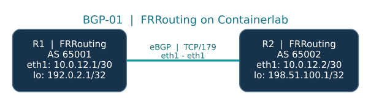

# BGP-01 — Primul laborator eBGP (FRRouting + Containerlab)

**Nivel:** începător · **Mediu:** Proxmox → Debian 12/13 sau Ubuntu Server 24.04 VM → Docker → Containerlab → FRRouting · **Scop:** sesiune eBGP între două AS-uri, schimb de prefixe /32, verificarea rutelor în Linux și troubleshooting.

Acest repository este pregătit pentru **GitHub și deploy automat**. După ce Debian/Ubuntu, Docker și Containerlab sunt instalate, trebuie doar să clonezi repository-ul și să rulezi **`make up`**. Routerele sunt pornite, configurate și verificate automat. Nu trebuie să introduci manual configurația BGP.

> **Ce înseamnă „totul UP”?** `make up` verifică dacă ambele containere rulează, sesiunile eBGP sunt **Established**, ambele /32-uri sunt instalate în tabela Linux și ping-ul între loopback-uri funcționează. Dacă testele eșuează, scriptul se oprește cu cod de eroare și oferă informații pentru diagnostic. Nu presupune succesul doar pentru că Docker a pornit containerele.

## 1. Schema topologiei



Sursă editabilă pentru diagramă: [`docs/topology.dot`](docs/topology.dot) (Graphviz) și [`docs/topology.mmd`](docs/topology.mmd) (Mermaid). Un rezumat text util în terminal:

```text
       R1 / FRRouting                                 R2 / FRRouting
     Autonomous System 65001                        Autonomous System 65002
  ┌──────────────────────────┐                  ┌──────────────────────────┐
  │ eth1: 10.0.12.1/30       │◄── eBGP TCP/179 ─►│ eth1: 10.0.12.2/30       │
  │ lo:   192.0.2.1/32       │    link eth1      │ lo:   198.51.100.1/32    │
  └──────────────────────────┘                  └──────────────────────────┘
          BGP router-id                                 BGP router-id
          192.0.2.1                                     198.51.100.1
```

| Parametru | R1 | R2 |
|---|---|---|
| FRRouting node | `r1` | `r2` |
| Container name | `clab-bgp01-r1` | `clab-bgp01-r2` |
| Local AS | `65001` | `65002` |
| Interfața BGP | `eth1` | `eth1` |
| IP pe link | `10.0.12.1/30` | `10.0.12.2/30` |
| Loopback (lo) | `192.0.2.1/32` | `198.51.100.1/32` |
| Peer IP | `10.0.12.2` | `10.0.12.1` |
| Remote AS | `65002` | `65001` |
| Prefix anunțat | `192.0.2.1/32` | `198.51.100.1/32` |

**Note:** ASN-urile 65001/65002 sunt private; adresele `192.0.2.0/24` și `198.51.100.0/24` sunt rezervate pentru documentație (RFC 5737). `eth0` este pentru management Containerlab/Docker, nu pentru peering-ul BGP. Linkul de date `eth1` este izolat la nivelul laboratorului.

## 2. Structura repository-ului

```text
BGP-01-Lab/
├── README.md                  # Acest ghid, inclusiv pregătirea Proxmox și GitHub
├── bgp01.clab.yml             # 2 routere FRRouting, conectate pe eth1
├── r1/frr.conf                # Configurație completă R1 / AS 65001
├── r2/frr.conf                # Configurație completă R2 / AS 65002
├── check.sh                   # Validare live BGP + RIB/kernel + ping
├── Makefile                   # make install/up/check/r1/r2/down
├── scripts/
│   ├── install-host.sh        # Instalare prerechizite pe Debian/Ubuntu VM
│   ├── deploy.sh              # Deploy Containerlab + validare automată
│   └── static_lint.py         # Verificare statică fără Docker
├── docs/
│   ├── topology.svg           # Schema vizuală pentru GitHub
│   ├── topology.dot           # Sursa Graphviz a schemei
│   ├── topology.mmd           # Schema editabilă în Mermaid
│   └── MANUAL-CONFIG.md       # Configurarea explicată, comandă cu comandă
├── tests/test-preflight.sh      # Regressions: Debian/Ubuntu VM vs Proxmox host
├── .github/workflows/lint.yml # GitHub Actions: validare statică
└── .gitignore                # Nu urcăm în Git fișierele generate de Containerlab
```

## 3. Pregătirea VM în Proxmox (o singură dată)

Creează o **VM nouă**, separată de clusterul Kubernetes/Talos sau alte servicii importante, din Proxmox → **Create VM**:

| Setare | Recomandare |
|---|---|
| Nume VM | `bgp-lab` |
| Guest OS | Debian 12/13 sau Ubuntu Server 24.04 LTS |
| vCPU | 4, CPU type `host` |
| RAM | 8 GB (pentru primul lab FRR) |
| Disk | 60 GB, SCSI/VirtIO |
| Network | VirtIO, pe `vmbr0` cu acces Internet |
| Guest Agent | QEMU Guest Agent (după instalarea în VM) |

Urmează instalarea standard Debian/Ubuntu și creează un utilizator cu drepturi `sudo`. Configurează accesul SSH și IP-ul VM-ului conform rețelei tale.

În VM-ul Debian/Ubuntu, verifică Internetul și DNS:

```bash
hostnamectl
ip -br address
ip route
ping -c 3 1.1.1.1
getent hosts containerlab.dev
```

**Nu instala Docker/Containerlab direct pe nodul Proxmox.** Hypervisorul Proxmox are la bază Debian, de aceea `/etc/os-release` poate raporta `ID=debian` atât pe host, cât și într-un guest Debian. Installerul verifică și blochează rularea pe hostul Proxmox și într-un container LXC/Docker; laboratorul se instalează doar într-o VM.

## 4. Instalarea Docker și Containerlab (o singură dată)

Metoda recomandată dacă ai clonat deja acest repo într-o VM Debian/Ubuntu:

```bash
make preflight  # verifică OS și blochează hostul Proxmox / LXC; nu instalează nimic
make install    # instalează utilitare și componentele Docker/Containerlab lipsă
```

Scriptul `scripts/install-host.sh` acceptă **Debian și Ubuntu** și instalează utilitarele, apoi folosește instalatorul oficial Containerlab *separat pentru componentele lipsă*. Dacă Docker există deja, nu îl reinstalează. Dezactivează modificările automate ale configurației `sshd` prin `SETUP_SSHD=false`. Nu îl executa pe hypervisorul Proxmox; pe acel sistem preflight-ul returnează eroare intenționat.

**Alternativ, comenzile manuale** (fără scriptul nostru):

```bash
sudo apt update
sudo apt install -y curl git make jq vim tcpdump traceroute \
    iproute2 iputils-ping unzip util-linux python3 python3-yaml qemu-guest-agent
sudo systemctl enable --now qemu-guest-agent
export SETUP_SSHD=false
curl -fsSL https://containerlab.dev/setup | sudo -E bash -s install-docker
curl -fsSL https://containerlab.dev/setup | sudo -E bash -s install-containerlab
sudo systemctl is-active docker
sudo docker --version
containerlab version
sudo docker run --rm hello-world
```

Instalatorul oficial primește privilegii administrative; citește mai întâi scriptul/documentația înainte de rulare, conform politicilor tale de securitate.

**Referință:** https://containerlab.dev/install/

## 5. Publică laboratorul pe GitHub

Dacă pornești de la arhiva ZIP, dezarhiveaz-o, deschide un terminal în directorul **`BGP-01-Lab`** și execută:

```bash
git init
git branch -M main
git add .
git commit -m "Initial BGP-01 eBGP Containerlab lab"
git remote add origin https://github.com/UTILIZATORUL_TAU/bgp-01-lab.git
git push -u origin main
```

Înainte de `git push`, creează pe GitHub un repository nou **gol**, de exemplu `bgp-01-lab` (fără README sau alte fișiere generate de GitHub) și înlocuiește `UTILIZATORUL_TAU` cu username-ul tău. Folosește autentificare GitHub via SSH sau credential manager/token; nu introduce parola contului în comandă.

**Notă:** acest ZIP nu este încă publicat automat pe contul tău GitHub. Pasul de publicare îți aparține.

## 6. Clonează pe VM și pornește automat

După publicarea în GitHub, conectează-te prin SSH pe VM Debian/Ubuntu:

```bash
sudo apt update && sudo apt install -y git make  # doar dacă lipsesc
mkdir -p ~/labs
cd ~/labs
git clone https://github.com/UTILIZATORUL_TAU/bgp-01-lab.git
cd bgp-01-lab
```

Dacă este prima utilizare a VM-ului, execută `make preflight` și apoi `make install`. Apoi, **o singură comandă pornește și validează complet laboratorul**:

```bash
make up
```

Acest target execută `scripts/deploy.sh`, care:

1. verifică prezența Docker, Containerlab și utilitarelor de rețea;
2. execută `sudo containerlab deploy -t bgp01.clab.yml` (Containerlab descarcă imaginea FRR, dacă lipsește);
3. aplică automat configurațiile din `r1/frr.conf` și `r2/frr.conf`;
4. verifică nodurile cu `sudo containerlab inspect`;
5. așteaptă convergența BGP (limită ajustabilă prin `WAIT_SECONDS`, implicit 120 secunde);
6. verifică **Established**, rutele remote `/32` în Linux și ping-ul bidirecțional între loopback-uri;
7. afișează `SUCCESS` doar când toate testele sunt trecute.

Poți rula și direct:

```bash
sudo containerlab deploy -t bgp01.clab.yml
bash check.sh --wait
```

Important: `containerlab deploy` se ocupă de configurația inițială, dar **nu garantează convergența**. Tocmai de aceea includem `check.sh`, nu ne bazăm doar pe `docker ps`.

## 7. Confirmă că eBGP este UP

Verifică starea generală:

```bash
make status
make check
```

În condiții normale, ambele containere apar `running`, iar testul automat confirmă:

```text
PASS: both neighbors Established; both remote /32 routes installed.
...
SUCCESS: BGP-01 operational (eBGP + routing + ping).
```

Dacă vezi `FAIL`, nu presupune că labul este funcțional; investighează cu comenzile din secțiunea 11.

În FRR, comanda `show bgp ipv4 unicast summary` afișează în coloana `State/PfxRcd` **numărul de prefixe** pentru o sesiune Established (aici de regulă `1`), nu textul `Established`. Comanda `show bgp ipv4 unicast summary established` filtrează vecinii care sunt în această stare.

## 8. Intră în CLI și inspectează BGP

```bash
make r1
```

În CLI-ul R1 (`vtysh`), execută:

```text
show bgp ipv4 unicast summary
show bgp ipv4 unicast
show bgp ipv4 unicast 198.51.100.1/32
show bgp neighbors
show ip route
show running-config
```

Pe R1 te aștepți să vezi ruta `198.51.100.1/32` prin **next-hop `10.0.12.2`**, cu **AS-PATH `65002`**.

Pe R2:

```bash
make r2
```

```text
show bgp ipv4 unicast summary
show bgp ipv4 unicast 192.0.2.1/32
show ip route
```

Pe R2 ruta către `192.0.2.1/32` este învățată de la R1, cu next-hop `10.0.12.1` și AS-PATH `65001`.

Comandă utilă *din Ubuntu, fără shell interactiv*:

```bash
sudo docker exec clab-bgp01-r1 vtysh -c 'show bgp ipv4 unicast summary'
```

## 9. Ce fac configurațiile automate (explicat)

Deschide [`r1/frr.conf`](r1/frr.conf) și [`r2/frr.conf`](r2/frr.conf). Pentru a învăța configurația **manual, comandă cu comandă**, citește [`docs/MANUAL-CONFIG.md`](docs/MANUAL-CONFIG.md), care oferă ambele configurații în CLI `vtysh`.

Pe scurt:

| Instrucțiune | Rol |
|---|---|
| `router bgp 65001` | Definește AS-ul local al R1. |
| `neighbor 10.0.12.2 remote-as 65002` | Declară peer-ul eBGP. |
| `bgp router-id 192.0.2.1` | Definește ID-ul BGP al R1. |
| `address-family ipv4 unicast` | Lucrăm cu rute IPv4 unicast. |
| `neighbor 10.0.12.2 activate` | Permite schimbul de prefixe IPv4 cu R2. |
| `network 192.0.2.1/32` | Anunță /32-ul local în BGP, dacă există exact în RIB. |
| `no bgp ebgp-requires-policy` | Doar pentru laboratorul introductiv: dezactivează obligativitatea politicilor eBGP. |

**Nu folosi setarea fără politici de import/export într-un AS de producție.** În lecția dedicată BGP policies o vom înlocui cu prefix-lists și route-maps.

## 10. Captură BGP, fără unelte suplimentare în container

Un terminal Debian/Ubuntu — tcpdump pe `eth1` din network namespace R1:

```bash
PID=$(sudo docker inspect -f '{{.State.Pid}}' clab-bgp01-r1)
sudo nsenter -t "$PID" -n tcpdump -ni eth1 -vv 'tcp port 179'
```

Alt terminal Debian/Ubuntu — restartează doar sesiunea BGP din laborator:

```bash
sudo docker exec clab-bgp01-r1 vtysh -c 'clear bgp 10.0.12.2'
```

Vei putea observa negocierea TCP și traficul BGP; pentru interpretarea mesajelor BGP OPEN, KEEPALIVE și UPDATE, exportă un PCAP și deschide-l în Wireshark. Închide captura cu `Ctrl+C`.

## 11. Exerciții și troubleshooting

### Instalarea se oprește: `found debian`

Această eroare aparținea primei versiuni a arhivei, care accepta doar Ubuntu. Versiunea actualizată acceptă Debian și Ubuntu în VM. Înainte de instalare, rulează:

```bash
cat /etc/os-release | grep -E '^(ID|VERSION_ID)='
command -v pveversion || true
systemd-detect-virt
make preflight
```

Dacă `pveversion` există, probabil ești conectat la **hostul Proxmox**; nu instala Docker acolo, ci într-o VM. Dacă `make preflight` raportează `PASS`, continuă cu `make install` și `make up`. Dacă rulezi deja o versiune veche clonată de pe GitHub, publică întâi noile fișiere și actualizează local cu `git pull --ff-only`.

### Exercițiul A — întrerupe legătura

```bash
sudo docker exec clab-bgp01-r1 ip link set eth1 down
sudo docker exec clab-bgp01-r1 vtysh -c 'show bgp ipv4 unicast summary'
sudo docker exec clab-bgp01-r1 ip -4 route show 198.51.100.1/32
```

Observă dispariția sesiunii și a prefixului din kernel. Refă legătura:

```bash
sudo docker exec clab-bgp01-r1 ip link set eth1 up
bash check.sh --wait
```

### Exercițiul B — diagnosticul din host

```bash
sudo docker ps --filter name=clab-bgp01-
sudo docker logs --tail 80 clab-bgp01-r1
sudo docker logs --tail 80 clab-bgp01-r2
sudo docker exec clab-bgp01-r1 ip -br addr
sudo docker exec clab-bgp01-r2 ip -br addr
sudo docker exec clab-bgp01-r1 ip -4 route
sudo docker exec clab-bgp01-r1 vtysh -c 'show running-config'
```

**Verifică în această ordine:** containerele, `eth1`/IP-urile, reachability între IP-urile de link, neighborship-ul BGP, `network` și originea loopback-ului, apoi tabela de routing (BGP RIB → FRR/zebra → Linux).

### Exercițiul C — întrebări de verificare

1. De ce `remote-as` este diferit pentru R1 și R2?
2. Care este diferența dintre o sesiune TCP Established și o sesiune BGP Established?
3. Ce înseamnă `network 192.0.2.1/32`? Creează aceasta singură un IP pe loopback?
4. De ce next-hop-ul R1 pentru `198.51.100.1/32` este `10.0.12.2`?
5. Care este diferența dintre BGP RIB și ruta instalată în tabela Linux?
6. Cum recunoști în `show bgp summary` o sesiune Established?

## 12. Salvarea modificărilor și teardown

Containerlab rulează `kind: frr`, cu `startup-config` referind fișierele din repo și `enforce-startup-config: true`. Fișierele `r1/frr.conf` și `r2/frr.conf` sunt **sursa de adevăr** pentru deploy-ul automat.

Dacă modifici routerul prin `vtysh`, modificările sunt vizibile în running config; salvările FRR/Containerlab se fac în directorul generat `clab-bgp01/`, care este ignorat de Git. La următorul deploy, configurația versionată din repo este reaplicată. Pentru modificări persistente, editează `r1/frr.conf` / `r2/frr.conf` și recreează laboratorul:

```bash
make down
make up
```

Oprire/ștergere resursele **doar pentru acest lab** (nu șterge VM sau alte laboratoare):

```bash
make down
```

Actualizare de pe GitHub (când ai publicat modificările):

```bash
git pull --ff-only
make down
make up
```

## 13. Verificarea fișierelor

```bash
make lint
```

Rulează și `make test-preflight` pentru a testa că scriptul de instalare acceptă un guest și refuză un host Proxmox (fără să instaleze nimic).

Acest test verifică sintaxa scripturilor shell și consistența statică a topologiei YAML/configurațiilor FRR. GitHub Actions execută același test static la `push` și `pull_request`. **Nu este un test de runtime**: verificarea efectivă a BGP se face pe VM-ul tău prin `make up` / `make check`.

## 14. Documentație oficială

- Containerlab: https://containerlab.dev/
- Instalare Containerlab: https://containerlab.dev/install/
- `kind: frr`: https://containerlab.dev/manual/kinds/frr/
- FRRouting BGP: https://docs.frrouting.org/en/latest/bgp.html

---

**Următoarea lecție:** BGP-02, doi upstream ISP și BGP path selection (LOCAL_PREF, AS-PATH, next-hop, MED). Pentru Nokia SR Linux există un laborator BGP-01 separat, care poate fi folosit în paralel cu această variantă FRR.
