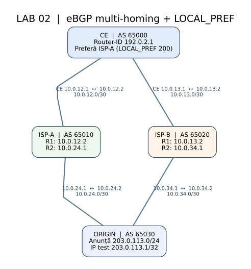

# BGP-02 — Dual ISP, LOCAL_PREF și Failover

**Platforme:** FRRouting (FRR) **și** Nokia SR Linux | **Orchestrare:** Docker + Containerlab + Makefile | **Mediu:** VM Linux în Proxmox | **Limba:** română.

Acesta este **un singur laborator cu două implementări echivalente**, organizat ca `lab02/` în [repository-ul BGP](https://github.com/borisux/bgp). Poți folosi aceeași schemă în FRRouting și în Nokia SR Linux ca să compari pas cu pas comenzile. Nu trebuie să scrii nicio comandă de configurare la pornire: fișierele `startup-config` sunt aplicate automat de Containerlab. Mai jos sunt și **comenzile BGP manuale pentru TOATE cele patru routere**, ca să înțelegi ce a fost configurat.

## 1. Obiective de învățare

1. Cum se stabilesc patru sesiuni eBGP, între patru AS-uri independente.
2. De ce același prefix este primit pe două căi și cum BGP alege una singură.
3. Cum funcționează `LOCAL_PREF` (200 prin ISP-A vs. 100 prin ISP-B), aplicat inbound **pe CE**.
4. Ce se întâmplă la întreruperea ISP-A; deosebirea dintre BGP RIB și forwarding/FIB.
5. Cum se configurează aceeași funcție în FRRouting și SR Linux.

## 2. Schema topologiei



Fișiere pentru modificarea schemei: [`docs/topology.mmd`](docs/topology.mmd) (Mermaid), [`docs/topology.dot`](docs/topology.dot) (Graphviz), plus [`docs/topology.png`](docs/topology.png).

```text
                   CE / AS 65000
              192.0.2.1/32 (loopback)
              /                 \
     10.0.12.0/30             10.0.13.0/30
             /                   \
      ISP-A AS 65010         ISP-B AS 65020
             \                   /
     10.0.24.0/30           10.0.34.0/30
              \                /
               ORIGIN / AS 65030
                203.0.113.0/24
```

| Router | ASN | Link 1 | Link 2 | Interfață virtuală |
|---|---:|---|---|---|
| CE | 65000 | către A: `10.0.12.1/30` | către B: `10.0.13.1/30` | `192.0.2.1/32` |
| ISP-A | 65010 | către CE: `10.0.12.2/30` | către ORIGIN: `10.0.24.1/30` | ID `10.10.10.10` |
| ISP-B | 65020 | către CE: `10.0.13.2/30` | către ORIGIN: `10.0.34.1/30` | ID `10.10.10.20` |
| ORIGIN | 65030 | către A: `10.0.24.2/30` | către B: `10.0.34.2/30` | `203.0.113.1/32` SRL; `/24` FRR |

**Notă:** în FRR interfețele de date sunt `eth1` și `eth2`; în SR Linux sunt `ethernet-1/1.0` și `ethernet-1/2.0`. `eth0`/`mgmt0` sunt rezervate managementului. Prefixele de forma 192.0.2.0/24 și 203.0.113.0/24 sunt doar pentru documentație/test.

### Căile BGP pe routerul CE

| Sursa | Next hop | AS-PATH văzut de CE | LOCAL_PREF pe CE | Rezultat |
|---|---|---|---:|---|
| ISP-A | `10.0.12.2` | `65010 65030` | **200** | Ruta principală |
| ISP-B | `10.0.13.2` | `65020 65030` | 100 | Ruta de backup |

BGP preferă **valoarea LOCAL_PREF mai mare**. LOCAL_PREF nu se propagă normal între AS-uri prin eBGP; politicile de *import* de pe CE o atribuie local.

## 3. Structura directorului pentru GitHub / GitLab

```text
lab02/
├── README.md                 # Documentația principală + configurații BGP manuale
├── Makefile                  # Comenzile unificate (PLATFORM=frr/srlinux)
├── docs/
│   ├── topology.svg          # Diagramă vizibilă direct în README
│   ├── topology.png
│   ├── topology.dot          # Sursă diagramă Graphviz
│   └── topology.mmd          # Sursă Mermaid
├── manual/
│   ├── FRROUTING.md          # Configurații FRR complete, pentru fiecare router
│   └── NOKIA-SRLINUX.md     # Comenzi SR Linux complete, pentru fiecare router
├── frr/                     # Topologie, 4 configurații FRR, Makefile, verificări
└── srlinux/                 # Topologie, 4 config-uri Nokia, Makefile, verificări
```

Cele două implementări au nume Containerlab diferite (`bgp02` și `bgp02-srl`) și se pot porni independent; recomandăm să rulezi una câte una pe o VM cu resurse limitate.

## 4. Cerințe

Rulează comenzile într-un **VM Debian/Ubuntu pe Proxmox**, NU direct pe nodul Proxmox: Docker, Containerlab, Python 3, GNU Make, `sudo` cu acces la Docker/Containerlab, `git`, `curl` pentru Nokia; suplimentar `iproute2`, `ping`, `nsenter` pentru testele FRR. Vezi și `make preflight PLATFORM=...`. Acest laborator **nu instalează automat dependențe în hypervizor**. SR Linux consumă semnificativ mai mult RAM decât FRRouting.

## 5. Pornirea complet automată

**FRRouting — recomandat pentru prima citire a topologiei:**

```bash
cd lab02
make preflight PLATFORM=frr
make lint PLATFORM=frr
make up PLATFORM=frr
make verify PLATFORM=frr
make ce PLATFORM=frr
```

**Nokia SR Linux — aceeași topologie, alt CLI:**

```bash
cd lab02
make preflight PLATFORM=srlinux
make lint PLATFORM=srlinux
make pull PLATFORM=srlinux
make up PLATFORM=srlinux
make verify PLATFORM=srlinux
make ce PLATFORM=srlinux
```

`PLATFORM=srlinux` este valoarea implicită: `make up` pornește Nokia, iar `make up PLATFORM=frr` pornește FRR. Comenzile pot fi rulate și separat în `frr/` respectiv `srlinux/` cu Makefile-ul lor.

## 6. Comenzi Makefile

| Comandă | Efect |
|---|---|
| `make preflight PLATFORM=...` | Verifică uneltele și Docker |
| `make lint PLATFORM=...` | Validare statică a structurii/topologiei |
| `make pull PLATFORM=...` | Descarcă imaginea de container |
| `make up PLATFORM=...` | Deploy + config automat + validare |
| `make verify PLATFORM=...` | Verifică sesiuni și ruta așteptată |
| `make status PLATFORM=...` | Inspectează topologia |
| `make routes PLATFORM=...` | Prefixul `203.0.113.0/24` în BGP CE |
| `make ce PLATFORM=...` | CLI pe CE |
| `make isp-a PLATFORM=...` | CLI pe ISP-A |
| `make isp-b PLATFORM=...` | CLI pe ISP-B |
| `make origin PLATFORM=...` | CLI pe ORIGIN |
| `make failover PLATFORM=...` | Simulează întreruperea ISP-A |
| `make restore PLATFORM=srlinux` | Reactivează ISP-A pe Nokia (FRR restaurează automat) |
| `make reset PLATFORM=...` | Distruge și recreează config-ul inițial |
| `make down PLATFORM=...` | Distruge numai topologia selectată |

## 7. Configurare manuală FRRouting — toate routerele

Într-o sesiune `vtysh`, comenzile BGP intră sub `configure terminal`. Mai jos este configurația **BGP exactă** din `frr/<router>/frr.conf`. Interfețele și configurațiile complete sunt în [`manual/FRROUTING.md`](manual/FRROUTING.md). Pentru a observa setările aplicate automat: `show running-config` și `show bgp ipv4 unicast summary`.

### FRR CE — AS 65000

```text
configure terminal
route-map FROM-ISP-A permit 10
 set local-preference 200
exit
!
route-map FROM-ISP-B permit 10
 set local-preference 100
exit
!
router bgp 65000
 bgp router-id 192.0.2.1
 no bgp ebgp-requires-policy
 no bgp default ipv4-unicast
 neighbor 10.0.12.2 remote-as 65010
 neighbor 10.0.12.2 description ISP-A
 neighbor 10.0.13.2 remote-as 65020
 neighbor 10.0.13.2 description ISP-B
 !
 address-family ipv4 unicast
  neighbor 10.0.12.2 activate
  neighbor 10.0.12.2 route-map FROM-ISP-A in
  neighbor 10.0.13.2 activate
  neighbor 10.0.13.2 route-map FROM-ISP-B in
  network 192.0.2.1/32
 exit-address-family
exit
!
end
```

### FRR ISP-A — AS 65010

```text
configure terminal
router bgp 65010
 bgp router-id 10.255.0.10
 no bgp ebgp-requires-policy
 no bgp default ipv4-unicast
 neighbor 10.0.12.1 remote-as 65000
 neighbor 10.0.12.1 description CE
 neighbor 10.0.24.2 remote-as 65030
 neighbor 10.0.24.2 description ORIGIN
 !
 address-family ipv4 unicast
  neighbor 10.0.12.1 activate
  neighbor 10.0.24.2 activate
 exit-address-family
exit
!
end
```

### FRR ISP-B — AS 65020

```text
configure terminal
router bgp 65020
 bgp router-id 10.255.0.20
 no bgp ebgp-requires-policy
 no bgp default ipv4-unicast
 neighbor 10.0.13.1 remote-as 65000
 neighbor 10.0.13.1 description CE
 neighbor 10.0.34.2 remote-as 65030
 neighbor 10.0.34.2 description ORIGIN
 !
 address-family ipv4 unicast
  neighbor 10.0.13.1 activate
  neighbor 10.0.34.2 activate
 exit-address-family
exit
!
end
```

### FRR ORIGIN — AS 65030

```text
configure terminal
router bgp 65030
 bgp router-id 203.0.113.1
 no bgp ebgp-requires-policy
 no bgp default ipv4-unicast
 neighbor 10.0.24.1 remote-as 65010
 neighbor 10.0.24.1 description ISP-A
 neighbor 10.0.34.1 remote-as 65020
 neighbor 10.0.34.1 description ISP-B
 !
 address-family ipv4 unicast
  neighbor 10.0.24.1 activate
  neighbor 10.0.34.1 activate
  network 203.0.113.0/24
 exit-address-family
exit
!
end
```

**Explicație FRR:** `neighbor ... remote-as` stabilește eBGP; `no bgp default ipv4-unicast` cere activarea explicită a fiecărui vecin în IPv4; `neighbor ... route-map FROM-ISP-A in` setează LOCAL_PREF numai pentru prefixele primite de la ISP-A; `network ...` exportă prefixe existente în RIB.

## 8. Configurare manuală Nokia SR Linux — toate routerele

În consola `sr_cli`, modifici configurația folosind `enter candidate`, apoi introduci comenzile `set / ...` și finalizezi cu `commit now`. În lab aceste comenzi sunt introduse automat din `srlinux/configs/*.cli`; le poți vizualiza fără schimbări folosind `info from running /network-instance default protocols bgp` și `info from running /routing-policy`. În exemplele de mai jos am extras **comenzile BGP și politicile** din fișierele reale; comenzile de IP/interfețe sunt în [`manual/NOKIA-SRLINUX.md`](manual/NOKIA-SRLINUX.md).

### Nokia CE

```text
enter candidate
set / network-instance default protocols bgp autonomous-system 65000
set / network-instance default protocols bgp router-id 192.0.2.1
set / network-instance default protocols bgp admin-state enable
set / network-instance default protocols bgp afi-safi ipv4-unicast admin-state enable
set / routing-policy policy EXPORT-LOCAL default-action policy-result reject
set / routing-policy policy EXPORT-LOCAL statement allow match protocol local
set / routing-policy policy EXPORT-LOCAL statement allow action policy-result accept
set / routing-policy policy PREFER-ISP-A default-action policy-result accept
set / routing-policy policy PREFER-ISP-A default-action bgp local-preference set 200
set / routing-policy policy PREFER-ISP-B default-action policy-result accept
set / routing-policy policy PREFER-ISP-B default-action bgp local-preference set 100
set / network-instance default protocols bgp group ISP-A export-policy [ EXPORT-LOCAL ]
set / network-instance default protocols bgp group ISP-A import-policy [ PREFER-ISP-A ]
set / network-instance default protocols bgp group ISP-A ipv4-unicast admin-state enable
set / network-instance default protocols bgp neighbor 10.0.12.2 admin-state enable
set / network-instance default protocols bgp neighbor 10.0.12.2 peer-group ISP-A
set / network-instance default protocols bgp neighbor 10.0.12.2 peer-as 65010
set / network-instance default protocols bgp group ISP-B export-policy [ EXPORT-LOCAL ]
set / network-instance default protocols bgp group ISP-B import-policy [ PREFER-ISP-B ]
set / network-instance default protocols bgp group ISP-B ipv4-unicast admin-state enable
set / network-instance default protocols bgp neighbor 10.0.13.2 admin-state enable
set / network-instance default protocols bgp neighbor 10.0.13.2 peer-group ISP-B
set / network-instance default protocols bgp neighbor 10.0.13.2 peer-as 65020
commit now
```

### Nokia ISP-A

```text
enter candidate
set / network-instance default protocols bgp autonomous-system 65010
set / network-instance default protocols bgp router-id 10.10.10.10
set / network-instance default protocols bgp admin-state enable
set / network-instance default protocols bgp afi-safi ipv4-unicast admin-state enable
set / routing-policy policy EXPORT-BGP default-action policy-result reject
set / routing-policy policy EXPORT-BGP statement allow match protocol bgp
set / routing-policy policy EXPORT-BGP statement allow action policy-result accept
set / routing-policy policy IMPORT-ALL default-action policy-result accept
set / network-instance default protocols bgp group CE export-policy [ EXPORT-BGP ]
set / network-instance default protocols bgp group CE import-policy [ IMPORT-ALL ]
set / network-instance default protocols bgp group CE ipv4-unicast admin-state enable
set / network-instance default protocols bgp neighbor 10.0.12.1 admin-state enable
set / network-instance default protocols bgp neighbor 10.0.12.1 peer-group CE
set / network-instance default protocols bgp neighbor 10.0.12.1 peer-as 65000
set / network-instance default protocols bgp group ORIGIN export-policy [ EXPORT-BGP ]
set / network-instance default protocols bgp group ORIGIN import-policy [ IMPORT-ALL ]
set / network-instance default protocols bgp group ORIGIN ipv4-unicast admin-state enable
set / network-instance default protocols bgp neighbor 10.0.24.2 admin-state enable
set / network-instance default protocols bgp neighbor 10.0.24.2 peer-group ORIGIN
set / network-instance default protocols bgp neighbor 10.0.24.2 peer-as 65030
commit now
```

### Nokia ISP-B

```text
enter candidate
set / network-instance default protocols bgp autonomous-system 65020
set / network-instance default protocols bgp router-id 10.20.20.20
set / network-instance default protocols bgp admin-state enable
set / network-instance default protocols bgp afi-safi ipv4-unicast admin-state enable
set / routing-policy policy EXPORT-BGP default-action policy-result reject
set / routing-policy policy EXPORT-BGP statement allow match protocol bgp
set / routing-policy policy EXPORT-BGP statement allow action policy-result accept
set / routing-policy policy IMPORT-ALL default-action policy-result accept
set / network-instance default protocols bgp group CE export-policy [ EXPORT-BGP ]
set / network-instance default protocols bgp group CE import-policy [ IMPORT-ALL ]
set / network-instance default protocols bgp group CE ipv4-unicast admin-state enable
set / network-instance default protocols bgp neighbor 10.0.13.1 admin-state enable
set / network-instance default protocols bgp neighbor 10.0.13.1 peer-group CE
set / network-instance default protocols bgp neighbor 10.0.13.1 peer-as 65000
set / network-instance default protocols bgp group ORIGIN export-policy [ EXPORT-BGP ]
set / network-instance default protocols bgp group ORIGIN import-policy [ IMPORT-ALL ]
set / network-instance default protocols bgp group ORIGIN ipv4-unicast admin-state enable
set / network-instance default protocols bgp neighbor 10.0.34.2 admin-state enable
set / network-instance default protocols bgp neighbor 10.0.34.2 peer-group ORIGIN
set / network-instance default protocols bgp neighbor 10.0.34.2 peer-as 65030
commit now
```

### Nokia ORIGIN

```text
enter candidate
set / network-instance default protocols bgp autonomous-system 65030
set / network-instance default protocols bgp router-id 203.0.113.1
set / network-instance default protocols bgp admin-state enable
set / network-instance default protocols bgp afi-safi ipv4-unicast admin-state enable
set / routing-policy policy EXPORT-STATIC default-action policy-result reject
set / routing-policy policy EXPORT-STATIC statement allow match protocol static
set / routing-policy policy EXPORT-STATIC statement allow action policy-result accept
set / routing-policy policy IMPORT-ALL default-action policy-result accept
set / network-instance default protocols bgp group ISP-A export-policy [ EXPORT-STATIC ]
set / network-instance default protocols bgp group ISP-A import-policy [ IMPORT-ALL ]
set / network-instance default protocols bgp group ISP-A ipv4-unicast admin-state enable
set / network-instance default protocols bgp neighbor 10.0.24.1 admin-state enable
set / network-instance default protocols bgp neighbor 10.0.24.1 peer-group ISP-A
set / network-instance default protocols bgp neighbor 10.0.24.1 peer-as 65010
set / network-instance default protocols bgp group ISP-B export-policy [ EXPORT-STATIC ]
set / network-instance default protocols bgp group ISP-B import-policy [ IMPORT-ALL ]
set / network-instance default protocols bgp group ISP-B ipv4-unicast admin-state enable
set / network-instance default protocols bgp neighbor 10.0.34.1 admin-state enable
set / network-instance default protocols bgp neighbor 10.0.34.1 peer-group ISP-B
set / network-instance default protocols bgp neighbor 10.0.34.1 peer-as 65020
commit now
```

**Explicație Nokia:**

- `network-instance default protocols bgp autonomous-system`: ASN-ul local.
- `group ISP-A/B`: peer-group cu politicile folosite.
- `neighbor ... peer-as`: ASN-ul de la celălalt capăt.
- `import-policy [ PREFER-ISP-A ]`: politica de primire care setează LOCAL_PREF 200.
- `export-policy [ EXPORT-STATIC ]`: permite explicit trimiterea prefixului static de pe ORIGIN către ISP-uri.
- `routing-policy policy EXPORT-BGP`: permite re-advertizarea prefixelor BGP de tranzit.

**Atenție la originea prefixului:** în FRR, ORIGIN are interfața loopback `203.0.113.1/24` și un `network 203.0.113.0/24`. În Nokia, ORIGIN are adresa `203.0.113.1/32` pe `system0.0`, o rută statică blackhole pentru `/24` și politica `EXPORT-STATIC` prin care o anunță în BGP. Acestea sunt două moduri diferite de a face disponibil același prefix. Rutarea către `/32` este mai specifică decât blackhole `/24`, deci destinația 203.0.113.1 poate răspunde la ping.

## 9. Verificare manuală și exerciții

### FRRouting

```bash
make ce PLATFORM=frr
```

```text
show bgp ipv4 unicast summary
show bgp ipv4 unicast 203.0.113.0/24
show running-config
show ip route bgp
```

Pe VM: `sudo docker exec clab-bgp02-ce ip -4 route show 203.0.113.0/24`. Așteptat `via 10.0.12.2`.

### Nokia SR Linux

```bash
make ce PLATFORM=srlinux
```

```text
show network-instance default protocols bgp summary
show network-instance default protocols bgp neighbor 10.0.12.2 detail
show network-instance default protocols bgp neighbor 10.0.13.2 detail
show network-instance default protocols bgp routes ipv4 prefix 203.0.113.0/24
show network-instance default route-table ipv4-unicast prefix 203.0.113.0/24 detail
info from running /routing-policy
info from running /network-instance default protocols bgp
```

### Exercițiul 1 — înțelege de ce câștigă ISP-A

Compară cele două căi în CE. Identifică `AS_PATH`, `next hop`, `LOCAL_PREF`, ruta best și protocolul din RIB. Verifică faptul că ambele sesiuni sunt established.

### Exercițiul 2 — modifică LOCAL_PREF manual

FRR (`make ce PLATFORM=frr`):

```text
configure terminal
route-map FROM-ISP-B permit 10
 set local-preference 250
exit
end
clear bgp ipv4 unicast 10.0.13.2 soft in
show bgp ipv4 unicast 203.0.113.0/24
```

Nokia (`make ce PLATFORM=srlinux`):

```text
enter candidate
set / routing-policy policy PREFER-ISP-B default-action bgp local-preference set 250
commit now
show network-instance default protocols bgp routes ipv4 prefix 203.0.113.0/24
```

Acum ar trebui să câștige ISP-B (250). Revino la valorile inițiale cu `make reset PLATFORM=frr` sau `make reset PLATFORM=srlinux`.

### Exercițiul 3 — întreruperea ISP-A

```bash
make failover PLATFORM=frr       # test și restaurare automată în aceeași execuție
make failover PLATFORM=srlinux   # dezactivează interfața CE -> ISP-A
make routes PLATFORM=srlinux
make restore PLATFORM=srlinux    # reabilitează ISP-A
```

Așteptat după întrerupere: ruta către `203.0.113.0/24` folosește **ISP-B / 10.0.13.2**. Aceasta este convergență BGP standard, nu un mecanism BGP Fast Reroute.

## 10. Cum urci proiectul pe GitHub sau GitLab

Arhiva se dezarhivează într-un director **`lab02/`**. În rădăcina repository-ului, lângă `lab01/`:

```bash
cd ~/labs/bgp
unzip /cale/catre/BGP-02-FRR-SRLinux.zip
git add lab02
git commit -m "Add lab02 dual ISP in FRRouting and Nokia SR Linux"
git push origin main
```

Aceleași comenzi funcționează pentru GitLab, dacă `origin` indică repository-ul tău GitLab. Verifică adresa cu `git remote -v`. Dacă branch-ul nu este `main`, folosește numele branch-ului curent.

## 11. Probleme frecvente și limite

- Imaginile SR Linux necesită resurse mai mari; dacă hostul nu are suficient RAM, rulează numai o platformă.
- În FRR poți utiliza `show bgp ...` și tabela kernel Linux; în Nokia consultă `show network-instance ...`.
- `make lint` verifică sintaxă Python/Shell și fișiere, **nu validează YANG/commit Nokia**.
- `make verify PLATFORM=srlinux` utilizează JSON-RPC cu `output-format: text`; dacă pe VM apar diferențe de ieșire între versiuni, scriptul poate necesita ajustarea parserului. Credentialele implicite pentru laborator sunt `admin`/`NokiaSrl1!`, configurabile prin `SRL_USER` și `SRL_PASSWORD`.
- Configurațiile Nokia SR Linux sunt testate static, **nu au fost pornite pe Proxmox-ul tău în această sesiune**. Validează BGP cu comenzile de mai sus după deploy.
- Toate echipamentele și adresele sunt izolate la nivel de laborator; nu conecta peeringurile la rețeaua de producție.

## 12. Referințe tehnice

- [Containerlab — Nokia SR Linux și startup-config CLI](https://containerlab.dev/manual/kinds/srl/)
- [Nokia SR Linux — comenzi BGP](https://learn.srlinux.dev/cli/show-commands/bgp/)
- [Nokia SR Linux — routing policies 25.10](https://documentation.nokia.com/srlinux/25-10/books/routing-protocols/route-policies.html)
- [JSON-RPC SR Linux — CLI text output](https://learn.srlinux.dev/tutorials/programmability/json-rpc/basics/)

---

**Convenția pentru seria de laboratoare:** vom continua în același format cu `lab03/`, `lab04/`, etc., fiecare cu `README.md`, schemă SVG/Mermaid, variantă FRRouting, variantă Nokia SR Linux, configurație BGP manuală și Makefile automatizat.
