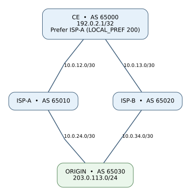

# BGP-02 — Dual-homed customer: LOCAL_PREF, best-path selection and failover

**Level:** Beginner → intermediate | **Stack:** Proxmox VM (Debian 12/13 or Ubuntu 24.04) → Docker → Containerlab → FRRouting 10.7.1 | **Duration:** 60–90 min of hands-on learning.

**Series repository:** https://github.com/borisux/bgp  
**Prerequisite:** complete `lab01` and use the same working VM. BGP-02 is an independent topology, with unique lab/container names, so it does not overwrite BGP-01.

> **Deployment contract:** `make up` creates four FRR routers with their startup configs, waits for all eBGP neighbors to be Established, sees both candidate paths to the common destination, validates ISP-A as the preferred kernel route and checks ICMP from CE's loopback to ORIGIN's loopback. If a check fails, it exits nonzero and shows diagnostics. No requirement to type configuration by hand before launch.

## 1. What you will learn

- Why receiving a prefix from **two upstream ISPs** does not mean installing two routes.
- How BGP **LOCAL_PREF** determines your preferred outbound path.
- How an AS_PATH proves the route was propagated through an upstream.
- How BGP reconverges to ISP-B when ISP-A stops advertising.
- How to distinguish the BGP RIB from the Linux kernel forwarding route.

We intentionally focus on **LOCAL_PREF and basic failover** in this lab. AS-PATH prepending, MED, iBGP and real import/export filters have separate future labs. We avoid changing multiple BGP attributes at once.

## 2. Topology



Editable topology sources: [`docs/topology.dot`](docs/topology.dot) (Graphviz) and [`docs/topology.mmd`](docs/topology.mmd) (Mermaid).

```text
                     CE / AS65000
                 lo 192.0.2.1/32
               /                   \
        10.0.12.0/30          10.0.13.0/30
             /                       \
       ISP-A / AS65010       ISP-B / AS65020
             \                       /
         10.0.24.0/30         10.0.34.0/30
               \                 /
                  ORIGIN / AS65030
                 lo 203.0.113.1/24
               announces 203.0.113.0/24
```

| Device | ASN | Data interfaces | Advertised prefix |
|---|---:|---|---|
| CE | 65000 | eth1 `10.0.12.1/30`; eth2 `10.0.13.1/30` | `192.0.2.1/32` |
| ISP-A | 65010 | eth1 `10.0.12.2/30`; eth2 `10.0.24.1/30` | Transits CE/ORIGIN |
| ISP-B | 65020 | eth1 `10.0.13.2/30`; eth2 `10.0.34.1/30` | Transits CE/ORIGIN |
| ORIGIN | 65030 | eth1 `10.0.24.2/30`; eth2 `10.0.34.2/30` | `203.0.113.0/24` |

All ASNs are private, and the loopback/public-like addresses are **documentation-only** ranges (RFC 5737). No prefix in the diagram is meant for the real Internet. Docker/Containerlab `eth0` is for lab management; BGP peers only use `eth1`/`eth2`.

Expected eBGP path on CE for `203.0.113.0/24`:

| Received from | AS-PATH as seen by CE | LOCAL_PREF set by CE | Selected? |
|---|---|---:|---|
| ISP-A, next hop `10.0.12.2` | `65010 65030` | **200** | **Yes** |
| ISP-B, next hop `10.0.13.2` | `65020 65030` | 100 | No (standby) |

**Important:** LOCAL_PREF is set by import policies **on CE**; it is not normally carried across eBGP sessions between different ASes. The larger value wins *before* AS-PATH comparison. Both ISP paths have the same number of AS hops so this first example is easy to interpret.

## 3. Prerequisites and safe host check

Run inside the **Debian/Ubuntu VM** you already provisioned for BGP-01, **not on the Proxmox hypervisor itself**. Suggested resources for both labs: 4 vCPU, 8 GB RAM, 60 GB disk. This lab's `make preflight` exits when it detects a Proxmox host or an LXC container, and it does **not** install anything.

Install Docker/Containerlab once via updated `lab01` if not already installed:

```bash
cd ~/labs/bgp/lab01
make preflight
make install
```

(The commands above are needed **only** for a fresh VM. The updated lab01 installer supports Debian guests and Ubuntu guests.)

For BGP-02:

```bash
cd ~/labs/bgp/lab02
make preflight
make lint
```

If `make lint` reports PyYAML missing: `sudo apt install python3-yaml`. `make up` needs working Docker, Containerlab and internet access for the first image pull. It doesn't modify Proxmox itself.

## 4. Deploy and validate automatically

```bash
cd ~/labs/bgp/lab02
make up
```

Under the hood `make up` runs:

```bash
sudo containerlab deploy -t bgp02.clab.yml
bash check.sh --wait
```

The image used (`quay.io/frrouting/frr:containerlab-10.7.1`) is the same native FRR Containerlab image family used in BGP-01. The topology starts with all four routers preconfigured. All **four sessions** (eight neighbor endpoints) must be established before the first check succeeds.

Expected final message (not a claim about an untested VM):

```text
SUCCESS: BGP-02 operational, both ISPs established; preferred ISP-A.
```

Handy commands:

```bash
make status            # inspect this lab
make check             # check baseline BGP+RIB+kernel+ping
make ce                # CE vtysh CLI
make isp-a             # ISP-A vtysh CLI
make isp-b             # ISP-B vtysh CLI
make origin            # origin vtysh CLI
```

From CE (`make ce`) run:

```text
show bgp ipv4 unicast summary
show bgp ipv4 unicast 203.0.113.0/24
show ip route bgp
show running-config
```

On VM Linux:

```bash
sudo docker exec clab-bgp02-ce ip -4 route show 203.0.113.0/24
```

Expected Linux next hop: `10.0.12.2`.

## 5. Hands-on exercises

Read **[`docs/EXERCISES.md`](docs/EXERCISES.md)** and complete in this order:

1. Inspect both received candidate paths and show why A wins.
2. Set the inbound LOCAL_PREF for A from `200` to `50`, issue a soft inbound refresh, prove B wins (`make check-b`).
3. Restore baseline (`make reset`) and simulate a BGP upstream outage (`make failover`). The script verifies the fallback and restores the BGP session.
4. Troubleshoot missing origin announcements and route changes, then restore configs.

**CLI changes made during the exercises are temporary.** `make reset` destroys only BGP-02 and reloads the versioned startup configs, so save intended configuration changes in `ce/frr.conf` or the relevant router config before recreating the lab.

## 6. Teardown, repeat, and share on GitHub

```bash
make down          # stop/remove only the BGP-02 containers and generated clab-bgp02/ folder
make up            # start over using checked-in configs
```

**Adding this folder to your existing `borisux/bgp` repository:**

If your repository is already cloned to `~/labs/bgp`, copy the provided `lab02/` folder into the root alongside `lab01` and `lab01-srlinux`. From the repository root run:

```bash
cd ~/labs/bgp
git status --short
git add lab02
git commit -m 'Add BGP-02 dual ISP Local Preference and failover lab'
git push origin main
```

If you downloaded the ZIP inside the VM, from `~/labs/bgp` run `unzip /path/to/BGP-02-Lab.zip` (it expands into `lab02/`), then commit. A ZIP is provided separately; it **has not** been pushed to your account. You own the GitHub credentials/commit.

Pull from GitHub on another VM:

```bash
git clone https://github.com/borisux/bgp.git
cd bgp/lab02
make up
```

## 7. How to troubleshoot

```bash
sudo containerlab inspect -t bgp02.clab.yml
sudo docker ps --filter name=clab-bgp02-
sudo docker exec clab-bgp02-ce vtysh -c 'show bgp ipv4 unicast summary'
sudo docker exec clab-bgp02-ce vtysh -c 'show bgp ipv4 unicast 203.0.113.0/24'
sudo docker exec clab-bgp02-ce ip -br address
sudo docker exec clab-bgp02-origin ip -4 route show 192.0.2.1/32
```

Inspect in order: containers → link addressing → BGP Established → received prefixes → LOCAL_PREF → RIB best path → kernel forwarding → return route → ICMP.

**Security/real-network note:** Like introductory BGP-01, `no bgp ebgp-requires-policy` is used only to keep the initial transit behavior simple. It does **not** demonstrate safe production-grade inbound/outbound route filtering. We will use explicit policy boundaries and route-leak protection in later labs. Do not reuse these configs on production edge routers.

## 8. Version and validation notes

`make lint` checks Bash syntax, parses topology YAML, and statically checks ASNs, links and critical BGP statements. This package was statically validated, **but not booted on your Proxmox VM**; runtime verification is performed by `make up` and `make check` on your machine. If you encounter errors, share the `make up` output so the lab can be made compatible with your environment.

Official references: [Containerlab FRRouting kind](https://containerlab.dev/manual/kinds/frr/) · [FRRouting BGP](https://docs.frrouting.org/en/latest/bgp.html) · [BGP best-path decision process](https://docs.frrouting.org/en/latest/bgp.html).

**Next: BGP-03 — AS-PATH prepending and inbound path engineering**, followed by MED and then iBGP with route reflectors.
