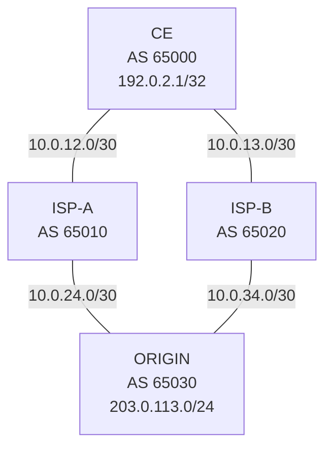

# Topologie — BGP-02 Nokia SR Linux

| Legătură | Local | Remote |
|---|---|---|
| CE ↔ ISP-A | `ce:e1-1` 10.0.12.1/30 | `isp-a:e1-1` 10.0.12.2/30 |
| CE ↔ ISP-B | `ce:e1-2` 10.0.13.1/30 | `isp-b:e1-1` 10.0.13.2/30 |
| ISP-A ↔ ORIGIN | `isp-a:e1-2` 10.0.24.1/30 | `origin:e1-1` 10.0.24.2/30 |
| ISP-B ↔ ORIGIN | `isp-b:e1-2` 10.0.34.1/30 | `origin:e1-2` 10.0.34.2/30 |

| Nod | Autonomous System | Router ID |
|---|---:|---|
| CE | 65000 | 192.0.2.1 |
| ISP-A | 65010 | 10.10.10.10 |
| ISP-B | 65020 | 10.20.20.20 |
| ORIGIN | 65030 | 203.0.113.1 |

Toate adresele și ASN-urile sunt pentru laborator, fără utilizare în rețele publice.
